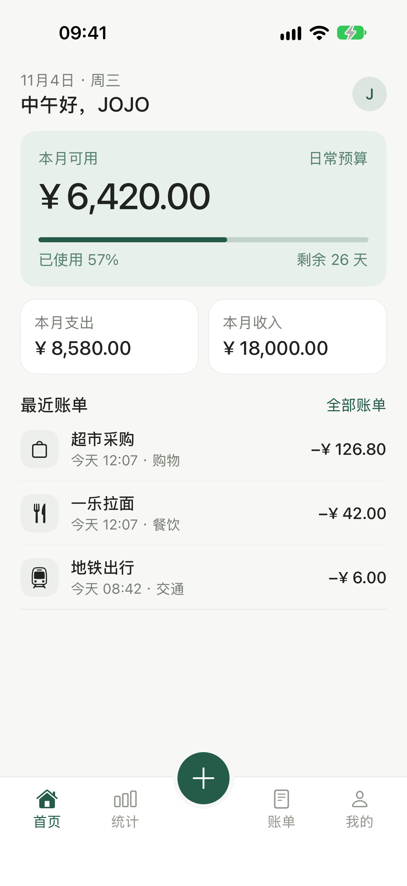
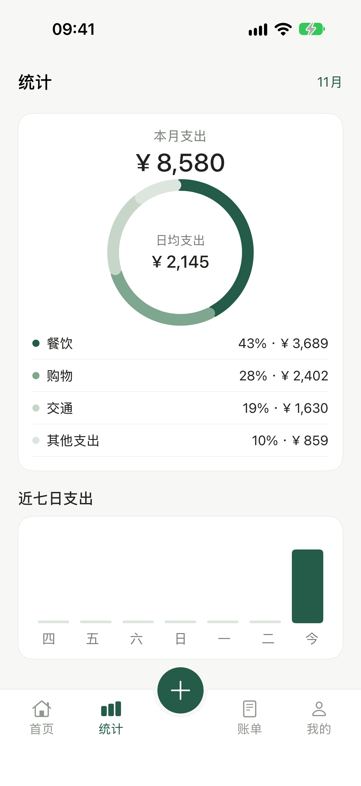
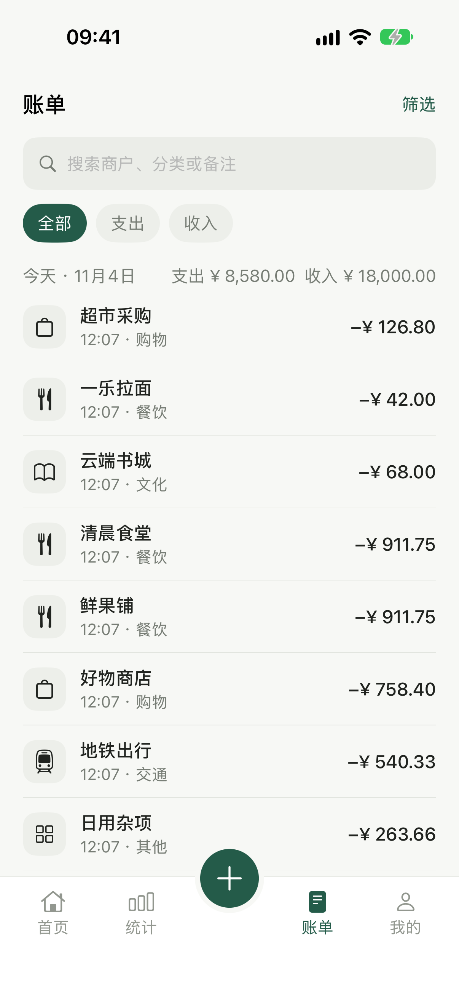
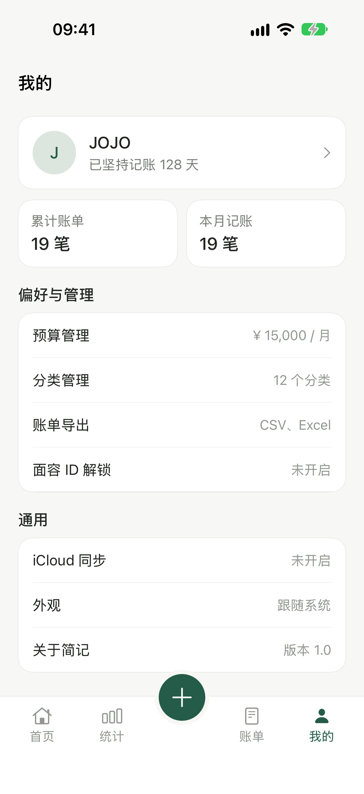
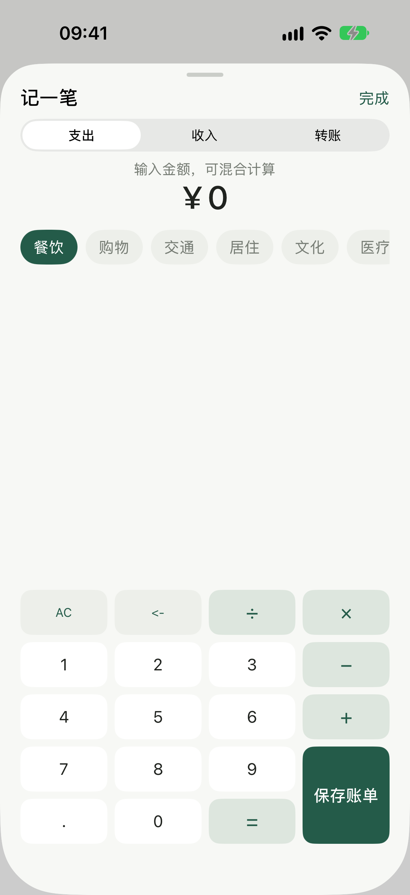

# JianJi (简记)

[简体中文](README.zh-CN.md) | English

> An iOS personal ledger that compresses bookkeeping into "a few seconds": tap to calculate, hold to speak, local-first data.

<table>
  <tr>
    <td align="center"><br><b>Home · Budget</b></td>
    <td align="center"><br><b>Statistics</b></td>
    <td align="center"><br><b>Bills</b></td>
    <td align="center"><br><b>Profile</b></td>
    <td align="center"><br><b>New Entry</b></td>
  </tr>
</table>

## Features

- **Tap to record**: built-in mixed-arithmetic calculator (+ − × ÷ precedence, AC / backspace / equals) — type an amount, get the math
- **Budget-first home**: "Available this month" as the hero metric, with budget progress, days remaining, and monthly in/out
- **Statistics**: monthly expense donut by category, weekly trend, daily average, switchable across months
- **Bills**: search by merchant / category / note, filter by date range, edit and delete from detail
- **Export**: CSV (UTF-8 BOM) or Excel XML, shared via the system share sheet
- **Privacy**: Face ID unlock with auto-lock on backgrounding; the ledger file lives on-device first
- **iCloud sync**: CloudKit private database (in progress)
- **Voice entry**: hold-to-talk → Chinese number & bill semantics parsing → confirm to save. The recognition state machine and parser are done and unit-tested; wiring into the home entry button is in progress

## Tech Stack

- Swift 5 · SwiftUI · zero third-party dependencies
- XCTest unit tests (36 cases) + XCUITest screenshot capture
- CloudKit (sync), LocalAuthentication (Face ID), `Transferable` file export

## Project Layout

```
JianJi/
├── App/          App entry & biometric lock
├── Models/       Transaction/category models and presets (LedgerAccounts, SampleData)
├── Services/     Store, persistence, CloudKit, export, biometrics, voice recognition & parsing
├── Utilities/    Calculator engine, formatters, Chinese number parsing, design system
└── Views/        Home / Statistics / Bills / Profile / entry sheet / voice overlay & confirmation
JianJiTests/      Unit tests
JianJiUITests/    UI tests (README screenshot capture)
docs/screenshots/ Screenshots
```

The project uses Xcode 16+ **filesystem-synchronized groups** (`PBXFileSystemSynchronizedRootGroup`): drop a file into a folder and it is automatically part of the build — no per-file project registration, so newly written code can never silently fail to compile.

## Requirements

| | |
|---|---|
| Xcode | 16 or later (project format objectVersion 77) |
| Deployment target | iOS 27.0, iPhone only, portrait |
| Signing | Automatic; iCloud sync requires a development team |

## Quick Start

```bash
open JianJi.xcodeproj

# Command-line build + full tests
xcodebuild -project JianJi.xcodeproj -scheme JianJi \
  -destination 'platform=iOS Simulator,name=iPhone 18 Pro' test
```

First launch seeds a sample ledger; replace it with your own data under Profile → Personal / Budget.

## Regenerating These Screenshots

Screenshots are captured by a UI test, so they always match the real UI:

```bash
# Optional: freeze the status bar for consistent shots
xcrun simctl status_bar booted override --time "9:41" --dataNetwork wifi --wifiBars 3 --batteryLevel 100

xcodebuild test -project JianJi.xcodeproj -scheme JianJi \
  -destination 'platform=iOS Simulator,name=iPhone 18 Pro' \
  -only-testing:JianJiUITests -resultBundlePath /tmp/shots.xcresult

xcrun xcresulttool export attachments --path /tmp/shots.xcresult --output-path /tmp/shots
# Rename per suggestedHumanReadableName in manifest.json, then drop into docs/screenshots/
```

## Data & Privacy

- The ledger is stored as `ledger.json` in the app sandbox; with sync enabled it goes to your CloudKit **private database** — no servers of ours are ever involved
- Face ID uses `LocalAuthentication`; biometric data never leaves the device, and the app collects no telemetry
- Export files are generated only on explicit user action and shared via the system share sheet

## License

[Apache License 2.0](LICENSE)
