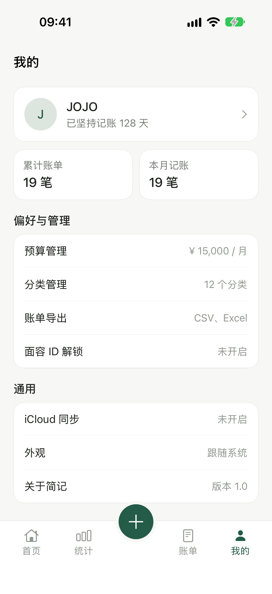
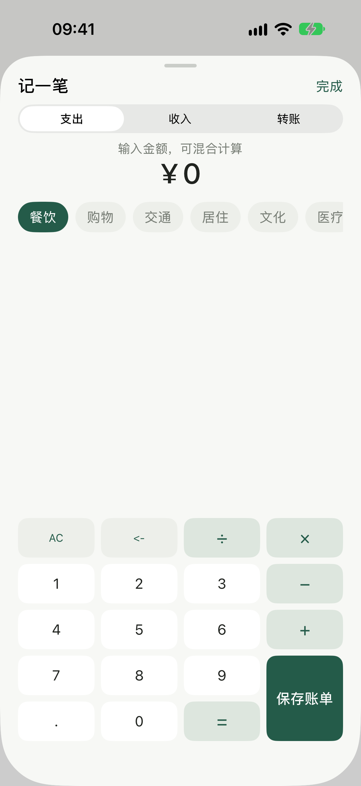
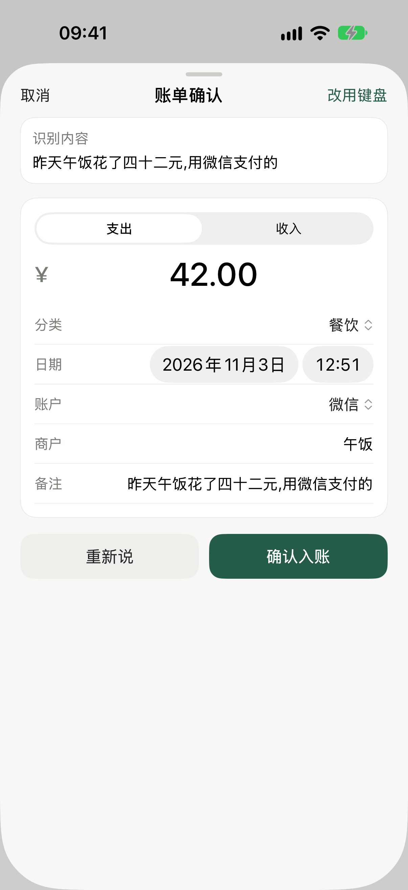

# 简记 (JianJi)

简体中文 | [English](README.md)


> 一款把记账压缩到「几秒钟」的 iOS 个人账本:点按即算、长按即说、数据本地优先。

<table>
  <tr>
    <td align="center"><br><b>首页 · 预算</b></td>
    <td align="center"><br><b>统计</b></td>
    <td align="center"><br><b>账单</b></td>
    <td align="center"><br><b>我的</b></td>
    <td align="center"><br><b>记一笔</b></td>
  </tr>
  <tr>
    <td align="center" colspan="5"> <br><b>语音记账 · 按住说话 → 确认入账</b></td>
  </tr>
</table>

## 特性

- **点按记账**:自带混合运算计算器(加减乘除优先级、AC / 退格 / 等号),金额即输即算
- **预算视角**:首页以「本月可用」为主视觉,预算进度、剩余天数、本月收支一目了然
- **统计**:月度支出分类占比(环形图)、周趋势、日均支出,可切换月份
- **账单**:按商户 / 分类 / 备注搜索,支持日期范围筛选,详情页可编辑与删除
- **导出**:CSV(带 UTF-8 标记)或 Excel XML,经系统分享面板分发
- **隐私**:Face ID 解锁、切后台自动上锁;账本文件优先存储于本地
- **iCloud 同步**:基于 CloudKit 私有数据库(开发中)
- **语音记账**:长按首页中央按钮即说,实时转写 → 中文数字与账单语义解析 → 确认入账;松手结束、上滑取消,点按仍是键盘记账。状态机与解析器均有单元测试

## 技术栈

- Swift 5 · SwiftUI · 零第三方依赖
- XCTest 单元测试(36 个用例)+ XCUITest 截图采集
- CloudKit(同步)、LocalAuthentication(Face ID)、`Transferable` 文件导出

## 工程结构

```
JianJi/
├── App/          应用入口与生物识别锁
├── Models/       账单/分类模型与预设(LedgerAccounts、SampleData)
├── Services/     状态容器、持久化、CloudKit、导出、生物识别、语音识别与解析
├── Utilities/    计算器引擎、格式化、中文数字解析、设计系统
└── Views/        首页/统计/账单/我的/记一笔面板/语音浮层与确认单
JianJiTests/      单元测试
JianJiUITests/    UI 测试(README 截图采集)
docs/screenshots/ 界面截图
```

工程使用 Xcode 16+ 的**文件系统同步组**(`PBXFileSystemSynchronizedRootGroup`):文件放进目录即自动纳入构建,无需逐个登记到工程文件,新增代码不会「写了却没编译」。

## 环境要求

| | |
|---|---|
| Xcode | 16 或更高(工程格式 objectVersion 77) |
| 部署目标 | iOS 27.0,仅 iPhone(竖屏) |
| 签名 | 自动签名,iCloud 需要同步开发团队 |

## 快速开始

```bash
open JianJi.xcodeproj

# 命令行构建 + 全量测试
xcodebuild -project JianJi.xcodeproj -scheme JianJi \
  -destination 'platform=iOS Simulator,name=iPhone 18 Pro' test
```

首次启动会写入示例账本,可在「我的 → 个人资料 / 预算」中改为自己的数据。

## 重新生成本 README 的截图

截图由 UI 测试驱动,保证与真实界面同步:

```bash
# 可选:冻结状态栏时间,让截图观感一致
xcrun simctl status_bar booted override --time "9:41" --dataNetwork wifi --wifiBars 3 --batteryLevel 100

xcodebuild test -project JianJi.xcodeproj -scheme JianJi \
  -destination 'platform=iOS Simulator,name=iPhone 18 Pro' \
  -only-testing:JianJiUITests -resultBundlePath /tmp/shots.xcresult

xcrun xcresulttool export attachments --path /tmp/shots.xcresult --output-path /tmp/shots
# 按 manifest.json 中的 suggestedHumanReadableName 重命名后放入 docs/screenshots/
```

## 数据与隐私

- 账本数据以 `ledger.json` 形式存储在应用沙盒内;开启同步后走 CloudKit **私有数据库**,不经过任何自建服务器
- Face ID 验证使用 `LocalAuthentication`,生物特征永不离开设备,应用也不采集任何遥测
- 导出文件完全由用户主动生成并通过系统分享面板分发

## License

[Apache License 2.0](LICENSE)
